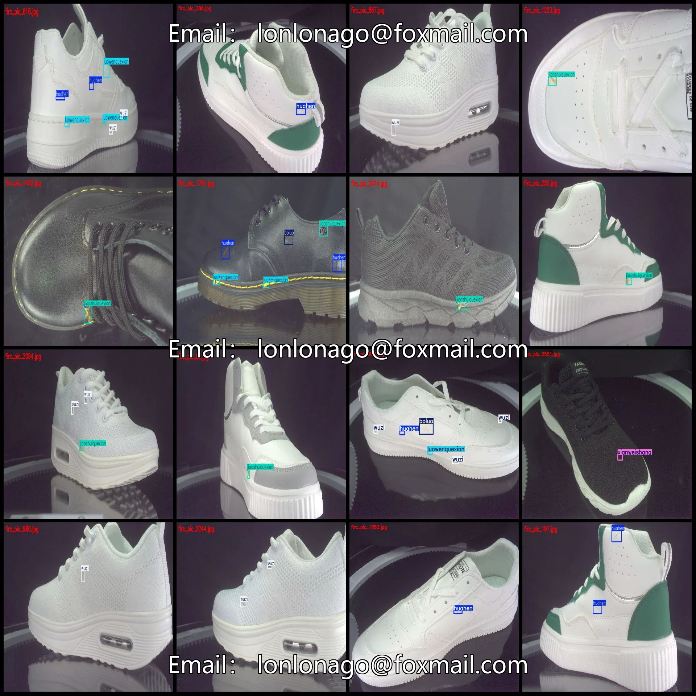
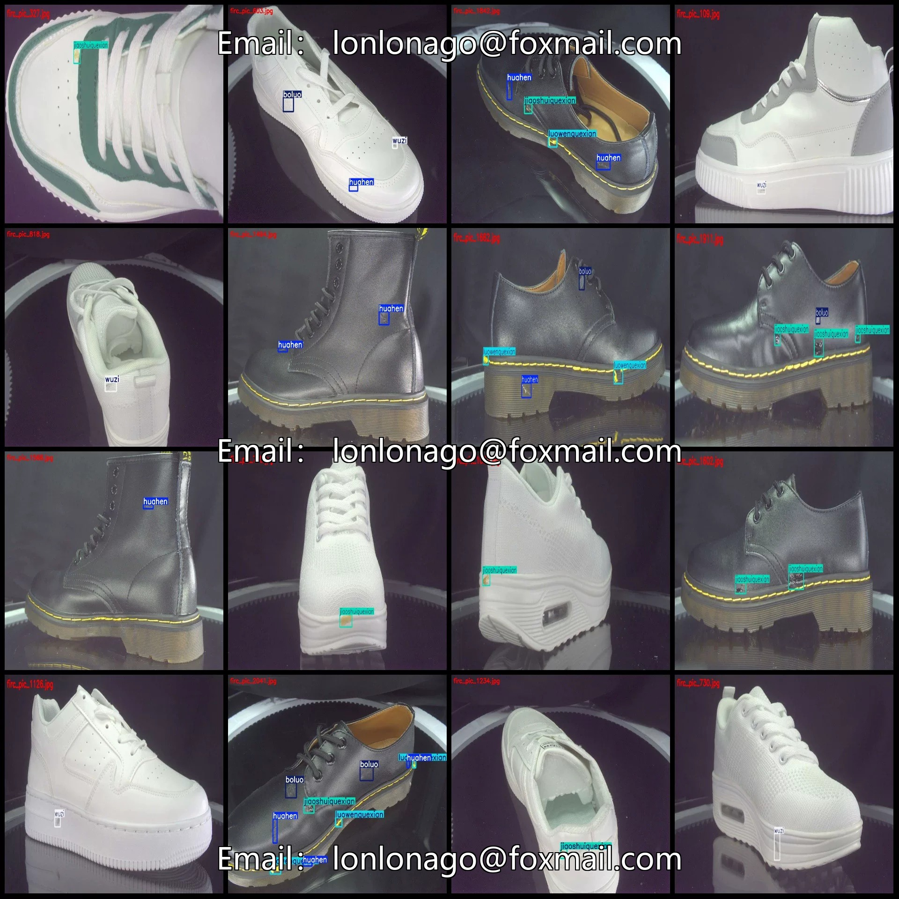
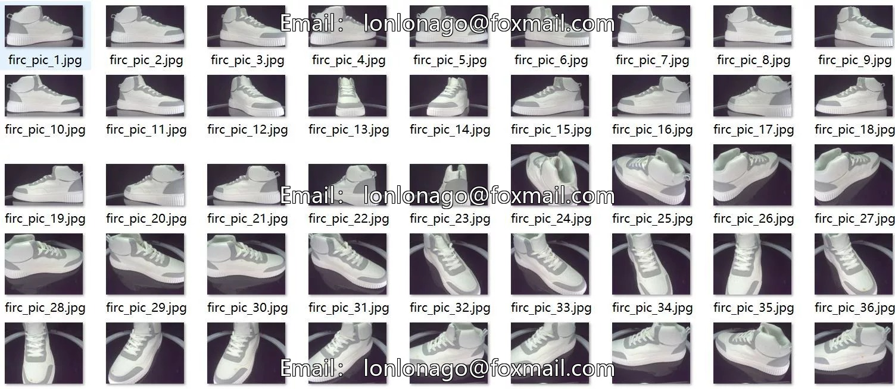
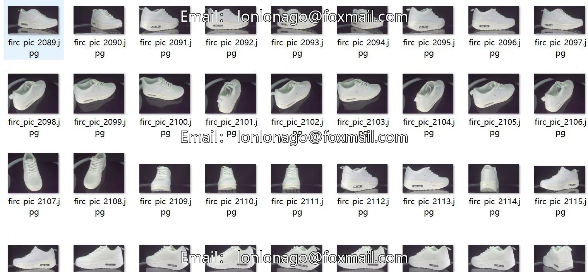
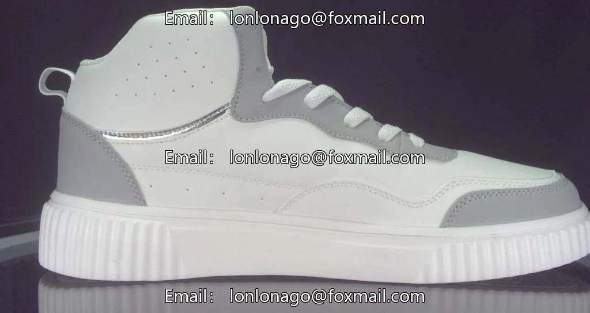
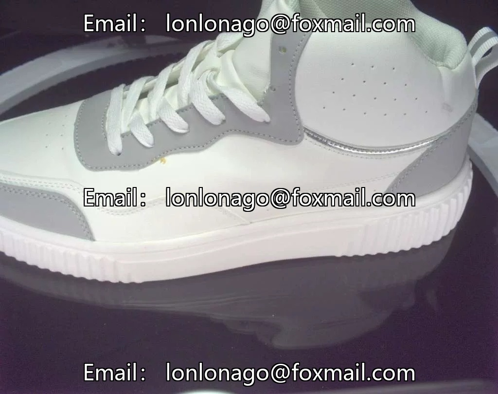
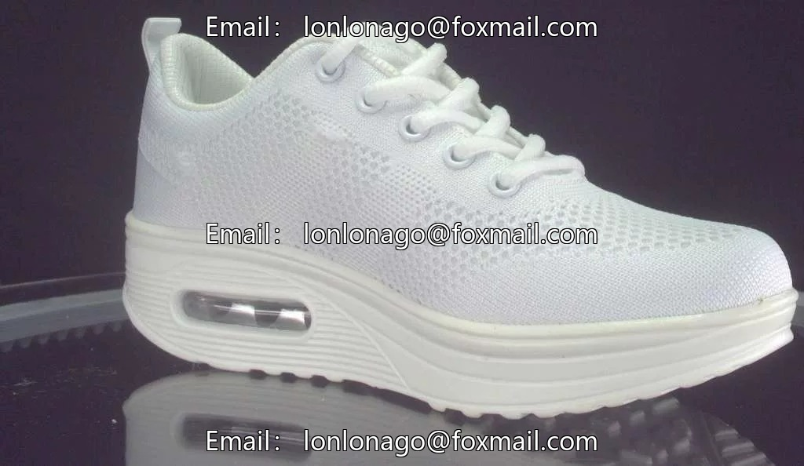

# Footwear Defects - Shoes Surface Defects - Unloading Quality Inspection Detection Data Set in VOC+YOLO format

## Body

Footwear Defects - Shoes Surface Defects - Unloading Quality Inspection and Testing Dataset in VOC+YOLO format with 2619 images across 6 categories
Warm Reminder: Due to the dataset's replicability, please confirm compliance before purchasing.
Dataset Format: Pascal VOC format + YOLO format (txt files without split paths, only containing jpg images along with corresponding VOC format xml files and yolo format txt files)
Number of Images (Total jpg files): 2619
Number of Annotations (Total xml files): 2619
Number of Annotations (Total txt files): 2619
Number of Annotation Categories: 6

Label category names (Note that the order of categories in the YOLO format does not correspond to this, but is based on the classes.txt file in the labels folder): ["boluo", "huahen", "jiaoshuiquexian", "luowenquexian", "wuzi", "xianweishang"]
Matching Chinese category name: ["Peel", "Scratch", "Glue Defects", "Thread Defects", "Dust", "Fiber Damage"]
Number of boxes labeled in each category
Boluo Frames = 640
Huahen Frame Count = 974
jiaoshuiquexian frame count = 1291

Frame count = 459
Frame count = 943
Frame count = 382
Total frame count: 4689
Number of images per category
Boluo has 489 images
Huahen has 659 images
Jiaoshuikexian has 1202 images
Luowenquexian has 315 images
Wuzi has 844 images
Xianweishang has 228 images
Image resolution: Multi-resolution images, such as 1024x809, 1024x564, etc.

Using labeling tool: labelImg
Labeling rules: Draw a rectangle around the category.
Important note: The dataset does not have separate training, validation, and test sets; you need to partition them yourself.
Special statement: This dataset does not guarantee the accuracy of the trained models or weight files.

## Images

## Payment

Here is a pay link on Stripe ( https://buy.stripe.com/3cs8yP7sY87d0vu9AB ). Please contact me lonlonago@foxmail.com after funding $89, and I will send you a complete data files , thank you!

